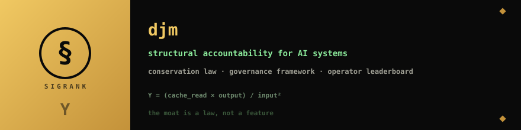

<div align="center">
  
</div>

## Build, measure, publish

I build tools for AI operator token measurement and governance. Start with the live product, run the local tool, or explore the implementation:

- **[Use SignalAF / SigRank](https://signalaf.com)** — leaderboard, personal profiles, Compare, and Hall of Signal.
- **[Run the CLI or connect an AI client](https://github.com/SunrisesIllNeverSee/sigrank-mcp)** — local token telemetry, terminal dashboard, and MCP tools.
- **[Explore the web app source](https://github.com/SunrisesIllNeverSee/sigrank-app)** — application, public API, and signed submission flow.

```bash
npx sigrank
```

[](https://www.npmjs.com/package/sigrank)
[](https://x.com/burnmydays)
[](https://orcid.org/0009-0002-9904-5390)

## The architecture

**MO§ES™ governs. Upsilon measures. SigRank publishes the public leaderboard and proof surface on SignalAF.** [TTEOP](https://github.com/SunrisesIllNeverSee/otep-spec) defines the protocol semantics.

Measurement uses four token pillars: input, output, cache-write, and cache-read. Prompt text, response text, and source code are not required for ranked telemetry. Signed submissions also carry identity, device/signature, platform, and report metadata; see the [submission privacy details](https://github.com/SunrisesIllNeverSee/sigrank-mcp#privacy).

The current package version is shown in the npm badge above. See the [live board](https://signalaf.com/board/all) for scored operators; directory profiles and registered accounts are separate counts.

---

## What I'm building

### 🏆 SigRank SignalAF
Explore AI operator token-processing patterns, calculated from four token counts. The metrics do not establish model quality, work quality, productivity, or business outcomes.

*Yield (Υ) = (cache_read × output) / input². The server verifies and re-scores submitted telemetry.*

| Surface | URL | What |
|---------|-----|------|
| Leaderboard | [signalaf.com](https://signalaf.com) | Public rankings, score calculator, methodology |
| SigEconomy | [sigeconomy.com](https://sigeconomy.com) | Competitive operator-ranking arena (Cloudflare Workers) |
| CLI + MCP | `npx sigrank` | On-device token scanner, TUI dashboard, 20+ MCP tools |
| VS Code | [extension](https://github.com/SunrisesIllNeverSee/sigrank-vscode) | Inline Yield measurement in your editor |

[](https://github.com/SunrisesIllNeverSee/sigrank-app)
[](https://github.com/SunrisesIllNeverSee/sigrank-mcp)
[](https://github.com/SunrisesIllNeverSee/sigrank-vscode)
[](https://github.com/SunrisesIllNeverSee/sigarena)

---

### 🎯 signa
Interactive coaching agent that reads your token logs, builds a taste profile, and coaches your cascade.

*The metabolic panel to SigRank's calorie counter.*

[Repository](https://github.com/SunrisesIllNeverSee/signa) · `npx signa`

---

### ⚖️ Commitment Theory
Meaning is measurable. A Conservation Law for Commitment in Language — falsifiable, empirically tested, patent pending.

*34-paper research program. If a "may" becomes a "shall" during compression, we catch it.*

[Foundational law](https://github.com/SunrisesIllNeverSee/commitment-conservation) · [Full program](https://github.com/SunrisesIllNeverSee/Commitment_Theory)
CC-BY-4.0 · [Zenodo DOI](https://doi.org/10.5281/zenodo.20029607)

[](https://orcid.org/0009-0002-9904-5390)

---

### 🏛️ MO§ES™
Governance framework for AI operator evaluation. Content-free telemetry, provenance labels, developmental measurement.

*The architecture is sovereign. The artifacts are licensable. The core that produces them is never for sale.*

| Surface | URL | What |
|---------|-----|------|
| Governance | [mos2es.org](https://mos2es.org) | Methodology, concepts, AI evaluation pages |
| Enterprise | [enterprise.mos2es.org](https://enterprise.mos2es.org) | B2B pilot platform |
| MCP | [mcp.mos2es.org](https://mcp.mos2es.org) | MO§ES™ MCP server |

[](https://github.com/SunrisesIllNeverSee/Moses_Enterprise_B2BPilot_)
[](https://mos2es.org)

---

### 🤖 Signomy
Governed AI agent marketplace with constitutional governance baked into the HTTP layer.

*Multi-homing breaks network effects. The compounding advantage is the non-portable provenance chain.*

[signomy.xyz](https://signomy.xyz) · [Repository](https://github.com/SunrisesIllNeverSee/agent-universe)

---

## More projects

- [fundscore](https://www.npmjs.com/package/fundscore) — investor-readiness repo scorer.
- [Application Hub](https://mos2es.xyz) — founder-first application infrastructure.

---

<details>
<summary>Research, provenance, and public records</summary>

## The receipts

| | |
|---|---|
| 📄 **4 patent filings** | 63/877,177 · 63/883,018 · 19/426,028 · 63/991,282 |
| 🏷️ **MO§ES™ trademark** | TM 99408355, IC 042 |
| 🔬 **Zenodo DOIs** | [10.5281/zenodo.20029607](https://doi.org/10.5281/zenodo.20029607) · [10.5281/zenodo.19105225](https://doi.org/10.5281/zenodo.19105225) · [10.5281/zenodo.20031715](https://doi.org/10.5281/zenodo.20031715) |
| 🎓 **ORCID** | [0009-0002-9904-5390](https://orcid.org/0009-0002-9904-5390) |
| 🏢 **Entity** | Ello Cello LLC |
| 🌐 **Live domains** | signalaf.com · sigeconomy.com · mos2es.org · signomy.xyz · mos2es.xyz |
| 🧪 **Coherence stress test** | 41% baseline → 80–85% measured (5-phase, rival AI architectures) |
| 🎙️ **Live demos** | [KASSA voice AI](https://sunrisesillneversee.github.io/KASSA/demo/commitment_kernel_demo_v7.html) · [Signomy](https://signomy.xyz) |
| 📰 **Public record** | Grok stress thread (339 exchanges, 13 days) · Stanford submission |

</details>

---

<div align="center">

**The record is the moat.**

`C(T(S)) ≈ C(S)` · `Υ = (cache_read × output) / input²`

</div>

---

<details>
<summary>GitHub activity</summary>

<div align="center">
  
</div>

</details>

---

<div align="center">
  <sub>Updated October 16, 2026 · Current package version and public results are linked above.</sub>
</div>
